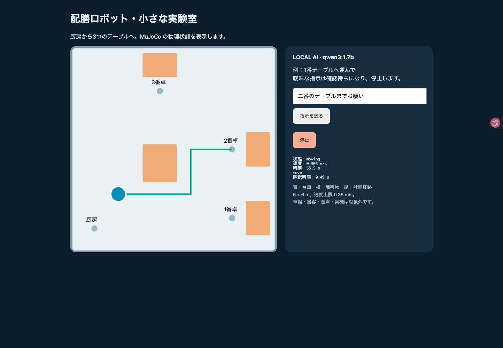

# 配膳ロボット Physical AI 試作

日本語指示をローカルQwen3で解釈し、MuJoCoで移動を計算します。

実行手順、評価結果、制約は [詳細README](serving_robot/README.md) を参照してください。

モデル・Ollamaバイナリ・仮想環境・認証情報は含みません。

## 検証結果

- 開発20例：キーワード9/20、初回AI14/20、改善後AI20/20。初回の失敗も保存しています。
- 追加15例：AI素出力11/15、安全検査後15/15。AIの誤移動提案4件を確認待ちへ戻しました。
- 物理・制御7テストと実AI接続4テストが成功。手作業で用意した小規模セットの結果で、一般的な安全性・精度を保証しません。

## 空間マッピング（作業ブランチ）

`feature/spatial-destinations` で、テーブル同士の間・近く・画面の四隅を候補表示し、明示確認後に移動する機能を実装。新プレビューは http://127.0.0.1:8767/ 。起動方法と新機能の評価は詳細README冒頭に記載。この作業ブランチはmainへ未マージです。
